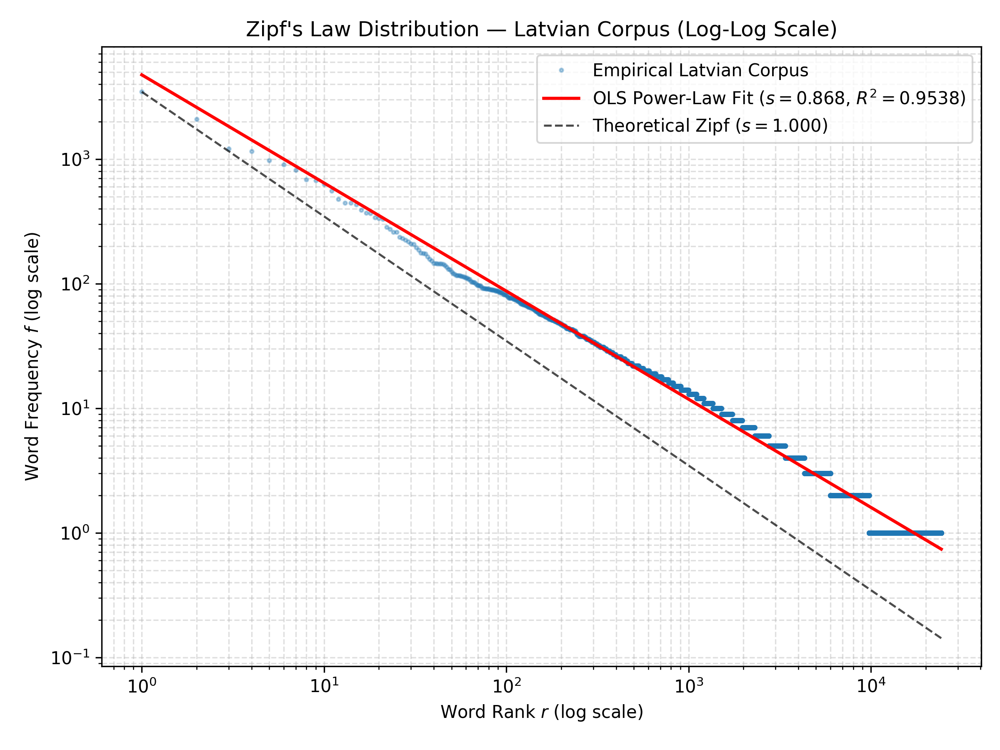

# NLP Project

A modular Python implementation of classical Natural Language Processing pipelines—covering corpus statistics & information theory, rule-based English syntax generation, and unsupervised semantic clustering.

> **Status:** Work in progress — Parts 1 and 2 are complete; Part 3 (Kohonen SOM semantic classifier) is currently planned.

## Modules & Progress

| Module | Scope | Status |
| :--- | :--- | :--- |
| **1. Statistical & Information-Theoretic Analysis** (`src/stats/`) | 100k+ word Latvian Wikipedia corpus: letter frequencies, Huffman coding & Shannon entropy, Zipf's law log-log OLS fit, 90% coverage core vocabulary, and word co-occurrence neighborhood graph. | Complete |
| **2. Rule-Based SVO Syntax Generator** (`src/syntax/`) | Finite-state English verb-phrase engine built over a 300-word lexicon (100 nouns, 100 verbs, 100 adjectives). Supports transitive, intransitive, and reflexive verbs, personal pronouns, determiners, active/passive voice, and all 16 tense/conditional × mood combinations. | Complete |
| **3. Semantic Clustering via Kohonen SOM** (`src/semantics/`) | Unsupervised 50-neuron Self-Organizing Map clustering 1,000 English nouns from verb–object (VO) co-occurrence vectors extracted via dependency parsing. | In Progress |

## Sample Output



## Project Structure

```text
.
├── data/                   # Input corpora and English lexicon (JSON)
├── results/                # Generated plots, CSV tables, and syntax paradigms
├── src/
│   ├── stats/              # Part 1: corpus loader, Huffman coding, Zipf, co-occurrence
│   ├── syntax/             # Part 2: English morphology & SVO sentence generator
│   └── semantics/          # Part 3 (planned): VO extractor & Kohonen SOM
├── main.py                 # CLI entrypoint
└── requirements.txt
```

## Usage

```bash
pip install -r requirements.txt

# Part 1: Statistical & information-theoretic analysis (Latvian Wikipedia)
python main.py --part 1

# Part 2: English SVO paradigm & random sentence generation
python main.py --part 2
```
---